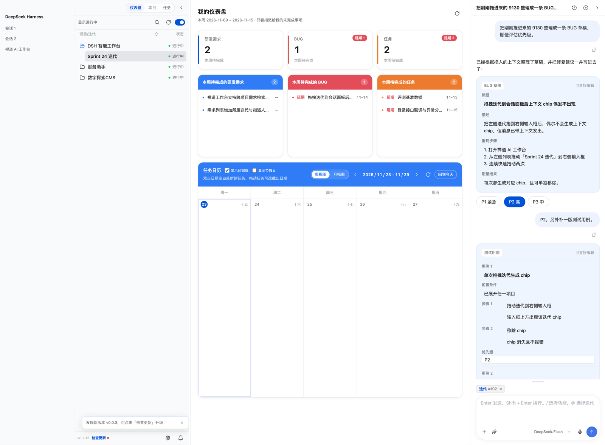
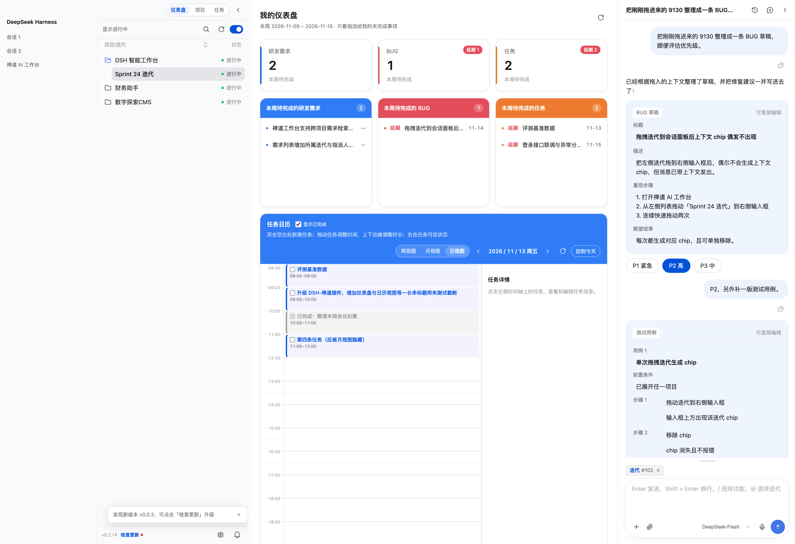
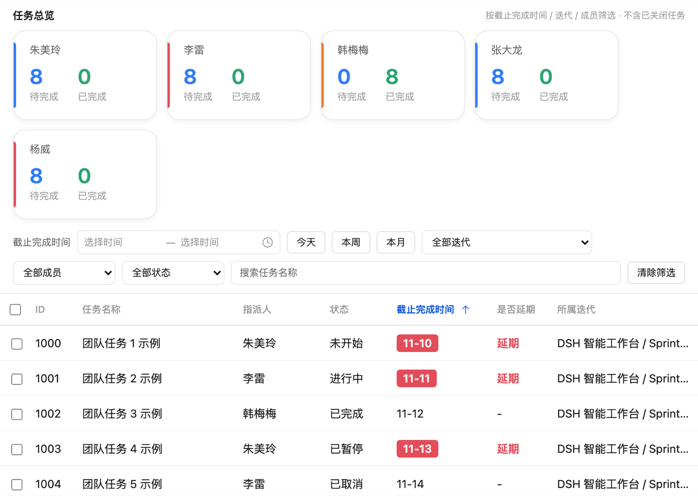
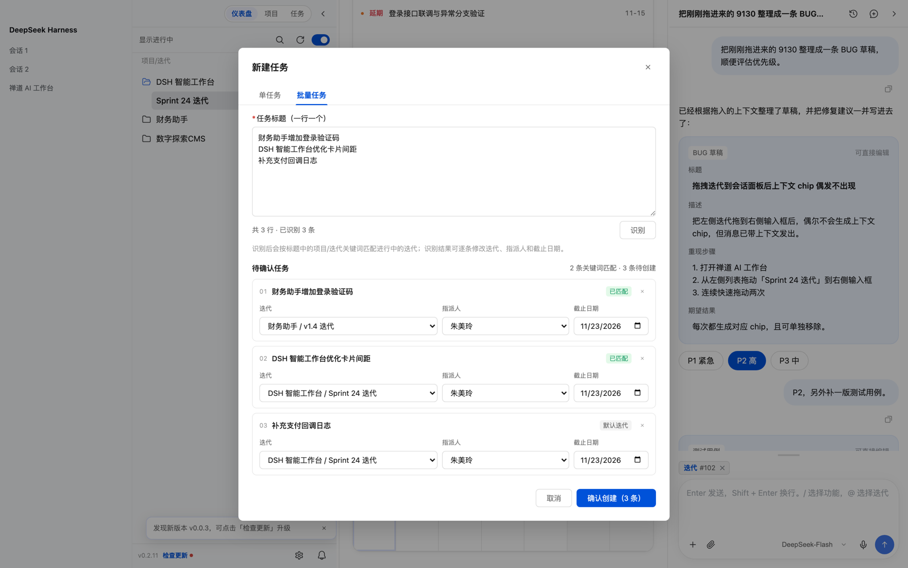

# 禅道 AI 工作台

把 [禅道 ZenTao](https://www.zentao.net/) 和 DeepSeek Harness 连起来的项目工作台。左侧浏览项目/迭代，中间看仪表盘与任务日历，右侧直接用 DeepSeek 对话查询、录入和修改禅道数据。



## 功能

- **项目 / 迭代树**：置顶、拖拽排序、搜索、展开/收起、显示进行中或全部。
- **工作台列表**：研发需求、BUG、任务、测试单、测试报告；支持列宽/列序、行内改状态、指派、优先级、模块、截止日期，以及「只看我」。
- **任务日历**：周/月/日视图。日视图提供 08:00–24:00 时间轴，可拖动任务改时间、拉伸上下边缘改工时，并同步禅道任务日期与预计工时；右侧详情可直接改指派人、迭代和描述。
- **周/月视图**：双击空白新建任务，拖动任务改截止日期，同日任务可拖动排序；可隐藏周末和法定节假日，已完成任务统一排在当天列表最后。
- **任务状态**：日历任务支持勾选完成，右键可切换未开始、进行中、已完成、已暂停、已取消、已关闭；暂停/取消任务置灰并显示 ❌。
- **批量建任务**：粘贴多行任务标题，按关键词自动匹配进行中的迭代，逐条确认/修改迭代、指派人、截止日期后一次创建。
- **DeepSeek 会话**：录入需求/BUG、批量建需求、改状态、新增迭代、粘贴图片解析；支持 DeepSeek 直连或使用 DSH 当前模型。
- **全员任务**：跨迭代汇总、成员/状态/截止日期/迭代筛选、行内编辑、批量修改、Excel 导出。
- **今日待办提醒**：DSH 启动后提示今天到期和已逾期的未完成任务，可在设置中关闭。
- **自动更新**：插件内检查新版本并提示安装。







## 环境要求

| 依赖 | 说明 |
| --- | --- |
| DeepSeek Harness | 需要支持 bundle + client 插件的桌面版 |
| 禅道 | 推荐 16.x；使用登录会话与 HTML 接口，「通用接口查询」依赖 REST API v1（`/api.php/v1/...`） |
| Node.js / pnpm | DSH 自带 Node；源码安装时 profile 需要 pnpm |
| SenseVoice（可选） | 语音输入依赖 DSH 的 speech-to-text 插件；未安装不影响其它功能 |

## 安装

### 通过 dsh-market / 插件市场

在 dsh-market 中搜索「禅道 AI 工作台」或 `dsh-zentao-workbench`，点击安装，重启 DeepSeek Harness。

### 直接安装 GitHub 仓库

```bash
dsh plugin --profile desktop add github:shuzitansuo/dsh-zentao-shuzitansuo
```

安装后重启 DeepSeek Harness，左侧会出现「禅道 AI 工作台」。

## 首次配置

安装后在插件设置中填写：

- 禅道地址（不要以 `/` 结尾）
- 禅道账号 / 密码
- 可选：DeepSeek API Key（不填则使用 DSH 当前模型）

也可以直接编辑 profile 里的 `cordis.patch.yml`：

```yaml
- insert:
    - id: zentao-workbench
      name: dsh-zentao-workbench
      config:
        baseUrl: 'http://你的禅道地址:端口'
        account: '你的账号'
        password: '你的密码'
        chatMode: custom
```

**不要把真实密码或 API Key 提交到公开仓库。** 仓库里的 `cordis.patch.yml` 只提供占位配置。

## 配置项

| 配置 | 默认 | 说明 |
| --- | --- | --- |
| `baseUrl` | — | 禅道地址，如 `http://192.168.1.10:8080` |
| `account` / `password` | — | 禅道登录账号，只保存在本机 |
| `showClosed` | `true` | 左树是否显示已关闭项目/迭代 |
| `chatMode` | `custom` | `custom` = 插件三栏聊天；`native` = 使用 DSH 原生会话 + agent tools |
| `assignmentWatch` | `true` | 轮询「我的 Bug/需求」做指派提醒（只读） |
| `assignmentIntervalMs` | `60000` | 指派提醒轮询间隔（毫秒） |
| `updateUrl` | 空 | 更新清单 JSON 地址；留空则「检查更新」提示未配置 |
| `deepseekApiKey` | 空 | DeepSeek 直连 Key；也可用环境变量 `DEEPSEEK_API_KEY` |
| `deepseekBaseUrl` | `https://api.deepseek.com` | DeepSeek API 地址 |
| `deepseekModel` | `deepseek-chat` | 直连模型，可改为 `deepseek-reasoner` |

## 更新

插件通过 `latest.json` 检查更新；新版本下载后由宿主替换插件文件，用户自己的 `cordis.patch.yml` 不会被覆盖。

## 开发

```bash
git clone https://github.com/shuzitansuo/dsh-zentao-shuzitansuo.git
cd dsh-zentao-shuzitansuo
```

把本目录以 `link:` 方式加入 DSH profile 的 `dependencies` 和 `dsh.profile.bundles`，然后重启 DeepSeek Harness。插件是无构建步骤的 ESM：`client.js` 是前端，`index.js` + `lib/` 是宿主侧。

## 许可证

MIT
